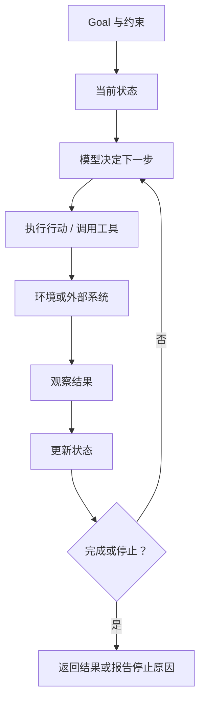

# Agent Loop：状态、反馈与停止

> [← 上一篇](01-core-concepts.md) · [课次入口](../README.md) · 下一篇：[Workflow、Agent 与自主性](03-workflows-and-autonomy.md)

Agent loop 是 agent 的运行结构：目标进入系统后，模型根据当前状态选择行动，行动作用于环境，系统读取结果并更新状态，再决定继续还是结束。

## 一次循环做什么

从外部可观察的角度看，一轮循环包含：

1. 读取当前状态：目标、约束、已有行动和观察、剩余预算。
2. 模型选择下一步：继续某个行动、换一种做法、请求信息，或声明完成。
3. 执行行动：调用工具、API、界面操作，或生成一个中间结果。
4. 获得观察：成功结果、失败信息、空结果、超时、权限拒绝。
5. 更新状态：记录行动与观察，更新中间产物和预算。
6. 判断是否停止：完成、无法继续、超出限制，或需要人工介入。



## 状态不只是聊天记录

Agent 的状态通常包括：

- 原始目标和约束；
- 已执行的动作、收到的观察；
- 已经产生或修改的文件、数据和中间结果；
- 剩余步数、时间、token 或费用预算；
- 当前权限和需要人工确认的事项。

模型能看到的上下文只是状态的一部分。长任务中，完整历史可能放在外部存储，按需检索、摘要或截断；如果状态管理出错，模型会重复行动、遗忘约束或在过期信息上继续决策。

## 反馈决定下一步是否有意义

Observation 可能成功，也可能失败、为空、超时或相互矛盾。一次可靠的循环会把工具错误当作观察处理，再决定重试、换工具、缩小任务或停止；不能把异常吞掉后假装成功。

Workflow 也可以读取反馈并走预设分支，所以“有反馈”本身不构成 agent。区别在于：反馈是否改变模型对下一步的选择，而不是只触发开发者预先写好的分支。

## 停止条件要显式

常见的终止方式：

- **目标完成**：有可验证的结果，或至少满足事先写明的完成条件；
- **模型声明完成**：可以作为信号，但最好由外部检查或测试确认；
- **预算用尽**：达到最大步数、时间、token 或费用上限；
- **无法继续**：不可恢复的错误、权限拒绝、缺少必要输入；
- **人工停止**：用户中断，或策略要求先确认。

只用 `while not done` 和模型口头说“完成”不够。外层循环需要硬限制，否则错误判断会变成无限重试或持续消耗。

伪代码中的完整终止写法见 [三种执行方式的伪代码](../examples/pseudocode.md#agent-loop)：一条路径返回 `completed`，另一条在步数用尽时返回 `step_limit`。

## 现代 Agent 的组件

| 组件 | 职责 | 本课关注点 |
| --- | --- | --- |
| Goal / User | 给出任务、约束和验收标准 | 目标是否可观察、可停止 |
| Agent runtime | 组织循环、状态、工具调用和日志 | 控制流与错误处理 |
| LLM | 理解上下文、选择下一步、解释结果 | 决策依据来自可见状态 |
| Instructions | 系统提示、工具说明、权限规则 | 约束模型能做什么 |
| Tools / Action 接口 | 把决策变成外部操作 | 参数、错误和副作用 |
| State / Memory | 保存目标、历史、中间产物和预算 | 哪些信息进入上下文 |
| Environment | 提供行动对象和反馈 | 真实结果而非模型猜测 |
| Observability | 记录行动、观察、耗时和成本 | 失败可追踪、可复盘 |

这张表会在后续 Module 中逐项展开。本课只需要能把它们放进同一个循环，而不是记住某个框架的目录结构。

模型侧常再区分三种能力：reasoning 处理约束和因果关系，planning 安排多步路径，action selection 决定当前执行哪个动作。它们不是三个独立进程，具体机制在 [M05](../../../syllabus.md#m05) 展开；本课只需要知道它们都服务于“下一步做什么”。

## MCP 在系统中的位置

MCP（Model Context Protocol）是连接上下文和工具的协议，不是 agent 本身。它解决的是“外部能力如何被描述、发现和调用”，不负责决定目标、选择下一步或判断任务是否完成。

```text
Agent 应用（MCP Host）
└── MCP Client ── MCP Server ── 外部应用 / 数据源
```

Host 是运行 agent 的应用；Host 内的 client 与 server 建立连接；server 向 client 暴露能力，最典型的是 tools，resources 和 prompts 也是协议能力的一部分，本课不展开。server 再把请求转成对具体应用或数据源的访问。

例如，一个概念上的 Blender MCP server 可以暴露 `create_cube` 这样的工具，agent 决定调用它，server 再访问 Blender。这里只是说明分层，不代表本仓库已经集成 Blender。MCP 规范的是连接和上下文交换方式；循环、状态和权限仍由 agent/host 负责。协议细节见 [MCP architecture](https://modelcontextprotocol.io/docs/learn/architecture)。

## 小结

Agent loop 把“决策—行动—观察—更新”连成闭环。状态决定模型看到什么，反馈决定下一步是否要改，停止条件决定循环何时安全结束。三者缺一，系统看起来在循环，实际上既不可控也不可验证。
